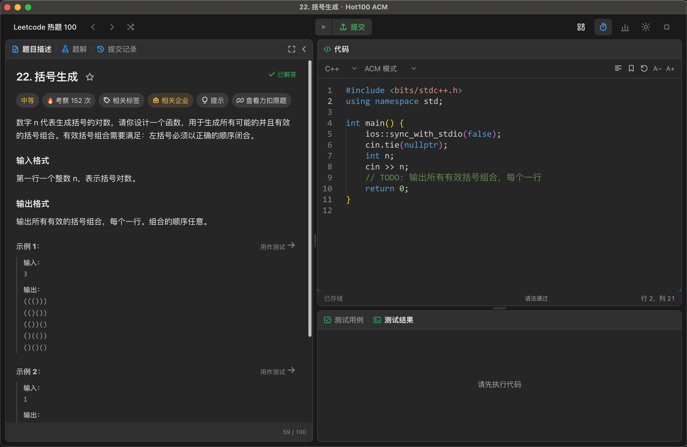
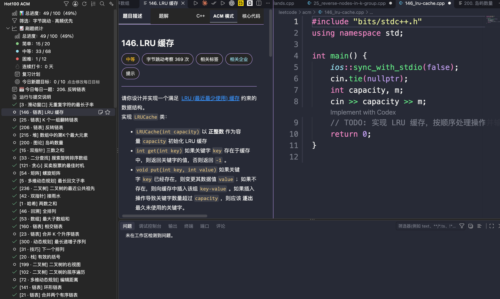

# Hot100 ACM 刷题台

[](https://marketplace.visualstudio.com/items?itemName=lovits.hot100-practice)
[](https://github.com/lovits/hot100-acm/releases/tag/v1.0.11)
[](https://github.com/lovits/hot100-acm/issues)

把 Hot100 算法练习、ACM 输入输出训练和间隔复习放进日常刷题流程。

本仓库提供两种使用方式：**独立桌面刷题台**和 **VS Code 插件**。两者均支持 Python、C++、C 的 ACM 与核心代码练习，学习进度各自保存在本机。

## 选择使用方式

| | 桌面刷题台 | VS Code 插件 |
| --- | --- | --- |
| 适合场景 | 打开独立应用，直接进入刷题界面 | 在熟悉的 VS Code 编辑器中练习 |
| 界面 | 左侧题目，右侧代码和测试区域 | 题库侧栏、左侧题面、右侧原生代码编辑器 |
| 本机测试 | 运行示例、自定义测试、提交本地评测 | 示例、自定义用例、全部用例评测 |
| 官网提交 | 以本机评测为主，可打开原题 | 核心代码模式登录力扣后提交官网 |
| 获取方式 | [macOS / Windows 安装包](https://github.com/lovits/hot100-acm/releases/tag/v1.0.11) | [VS Code Marketplace](https://marketplace.visualstudio.com/items?itemName=lovits.hot100-practice) · [离线 VSIX](https://github.com/lovits/hot100-acm/releases/tag/vscode-v0.2.82) |

## 安装

### VS Code：一条命令安装

```sh
code --install-extension lovits.hot100-practice
```

也可以在扩展市场搜索 **Hot100 ACM**。扩展标识为 `lovits.hot100-practice`，发布者为 `lovits`。

安装后打开一个保存练习代码的文件夹，从活动栏进入 Hot100 ACM，点击题目并选择语言即可开始。每次点击题目都会弹出语言选择；打开题目默认左侧题面、右侧代码。

若终端找不到 `code`，在 VS Code 命令面板执行 **Shell Command: Install 'code' command in PATH**。离线安装可下载 [VSIX](https://github.com/lovits/hot100-acm/releases/tag/vscode-v0.2.82)，在扩展面板选择“从 VSIX 安装”，或执行：

```sh
code --install-extension ./hot100-practice-0.2.82.vsix
```

### 桌面版：下载后启动

| 平台 | 下载 |
| --- | --- |
| macOS · Apple Silicon | [Hot100-macOS-arm64-release.zip](https://github.com/lovits/hot100-acm/releases/download/v1.0.11/Hot100-macOS-arm64-release.zip) |
| macOS · Intel | [Hot100-macOS-x64-release.zip](https://github.com/lovits/hot100-acm/releases/download/v1.0.11/Hot100-macOS-x64-release.zip) |
| Windows · x64 | [Hot100-Windows-x64-release.zip](https://github.com/lovits/hot100-acm/releases/download/v1.0.11/Hot100-Windows-x64-release.zip) |

macOS 解压后打开 `Hot100.app`；Windows 完整解压后，从 `Hot100/Start-Hot100.vbs` 启动。桌面包与插件独立发布，分别在对应 Release 中更新。

## 功能

### 桌面刷题台

- **直接刷题**：启动进入题目与代码界面，点击左上角题库名称打开选题侧栏。
- **两种模式**：ACM 模式训练完整输入输出，核心代码模式练习力扣函数或类接口。
- **本机运行**：支持 Python、C++、C，查看测试输入、输出、通过情况与错误信息。
- **组合选题**：按难度、完成状态、专题、公司筛选，支持搜索和高频排序。
- **题目信息**：查看算法标签、相关企业、考察次数、提示与原题链接。
- **练习记录**：自动保存代码草稿和本地进度，支持收藏、计时和布局调整。

### VS Code 插件

- **原生编辑**：使用 VS Code 编辑器、快捷键和本机工具链，ACM 与核心代码分别保留草稿。
- **题库筛选**：专题、算法标签、公司、难度、完成状态等条件可以组合使用，每类条件单选。
- **统一排序入口**：侧栏顶部“分组方式”提供按专题、按难度、按题号、高频优先；选定公司后，高频优先使用该公司考察次数。
- **运行与提交**：运行示例、手动添加用例、评测本地全部用例；核心代码支持登录力扣并提交官网。
- **学习计划**：月历展示实际练习记录，按历史完成记录安排间隔复习；支持修改目标、勾选复习完成和手动重置计划。
- **收藏与笔记**：保留题目收藏、个人笔记及刷题统计。
- **HTML 使用说明**：点击侧栏“运行与提交说明”，直接打开包含功能、执行命令和快捷键的页面。

## 界面预览

### 桌面刷题台

题面、代码编辑区和测试区域在同一窗口中展示。



### VS Code 插件

题库侧栏、左侧题面和右侧代码编辑器；截图来自实际使用场景。



## 运行、测试与提交

ACM 模式编写包含输入输出的完整程序；核心代码模式按题目模板实现函数或类。Python、C++、C 的本机评测使用本机可用的解释器或编译器。

在 VS Code 中，先聚焦题目代码文件，再通过命令面板执行：

| 命令 | 功能 |
| --- | --- |
| `Hot100 ACM: 本机运行示例` | 检查题目示例 |
| `Hot100 ACM: 本机自定义用例` | 手动填写输入和期望结果 |
| `Hot100 ACM: 本机评测全部用例` | 全部通过后更新本地完成记录 |
| `LeetCode: 提交代码` | 核心代码提交官网；Python/C++/C 的 ACM 文件执行本机全部用例评测 |

| 常用操作 | macOS | Windows / Linux |
| --- | --- | --- |
| 命令面板 | `Cmd + Shift + P` | `Ctrl + Shift + P` |
| 测试 | `Cmd + Option + T` | `Ctrl + Alt + T` |
| 提交 | `Cmd + Option + S` | `Ctrl + Alt + S` |
| 下一题 | `Cmd + Option + →` | `Ctrl + Alt + →` |
| 搜索题目 | `Cmd + Option + F` | `Ctrl + Alt + F` |

更多功能和快捷键可在插件侧栏的 **运行与提交说明** 页面中查看。本机用例通过与力扣官网判题通过分别记录。

## 题库与高频数据来源

- **题目来源**：[力扣 LeetCode Hot 100](https://leetcode.cn/studyplan/top-100-liked/)。题目说明、难度、标签及核心代码接口参考官方原题；ACM 模式补充本地输入输出格式。
- **高频与企业考察次数来源**：[CodeTop](https://codetop.cc/)。当前随包快照时间为 `2026-11-16T19:24:01+00:00`（北京时间 **2026-11-17**），并非实时统计。公司筛选下展示对应公司的次数，未指定公司时使用总次数。
- **核对记录**：题目逐题检查见 [leetcode-per-question-audit.json](reference/leetcode-per-question-audit.json)，插件核对记录见 [vscode-official-audit.json](reference/vscode-official-audit.json)。

## 从源码运行

安装 Python 3 后，在仓库根目录启动本地服务：

```sh
python3 local_server.py
```

浏览器打开 <http://127.0.0.1:18765>。本机评测还需要 Node.js，以及所选语言对应的解释器或编译器。

插件源码位于 [vscode-extension](vscode-extension/)，使用 `npm ci`、`npm run compile` 构建。

## 链接与许可

- [项目仓库](https://github.com/lovits/hot100-acm) · [插件主页](https://github.com/lovits/hot100-acm/tree/main/vscode-extension) · [问题反馈](https://github.com/lovits/hot100-acm/issues)
- [VS Code Marketplace](https://marketplace.visualstudio.com/items?itemName=lovits.hot100-practice) · [全部 Release](https://github.com/lovits/hot100-acm/releases)
- 插件保留原作者署名和 MIT 许可，见 [LICENSE](vscode-extension/LICENSE)、[上游版权说明](vscode-extension/UPSTREAM.md)与[原始声明快照](vscode-extension/licenses/upstream/)。
- 题目、图示、商标及第三方依赖的权利归各自权利人所有，不随代码的 MIT 许可转移。详情见 [THIRD_PARTY.md](vscode-extension/THIRD_PARTY.md)。本项目非力扣或 CodeTop 官方产品。
